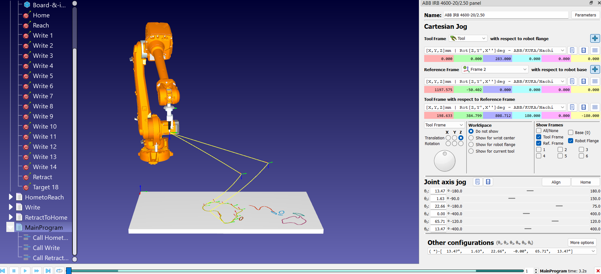
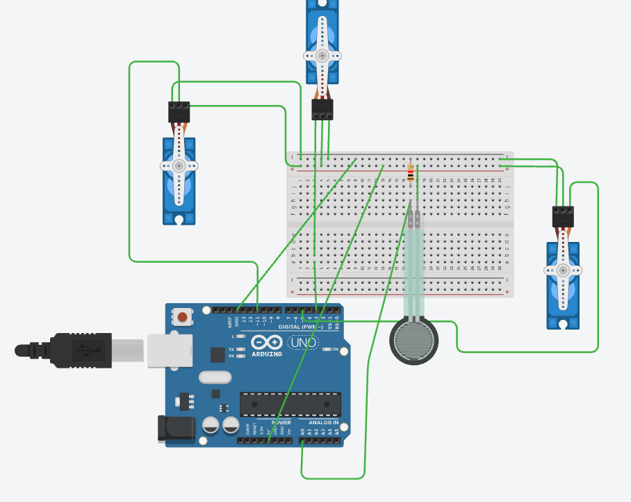
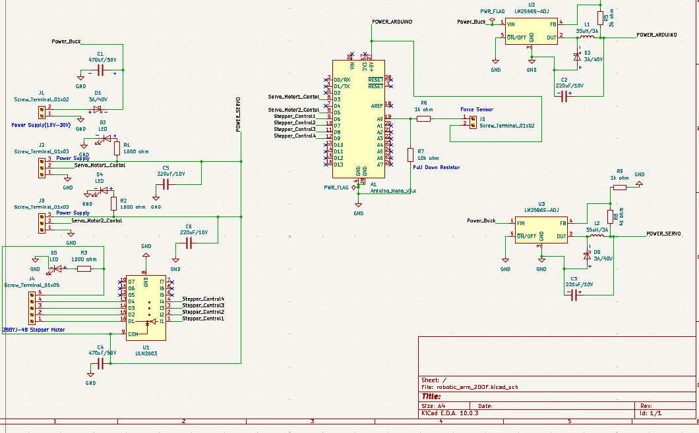
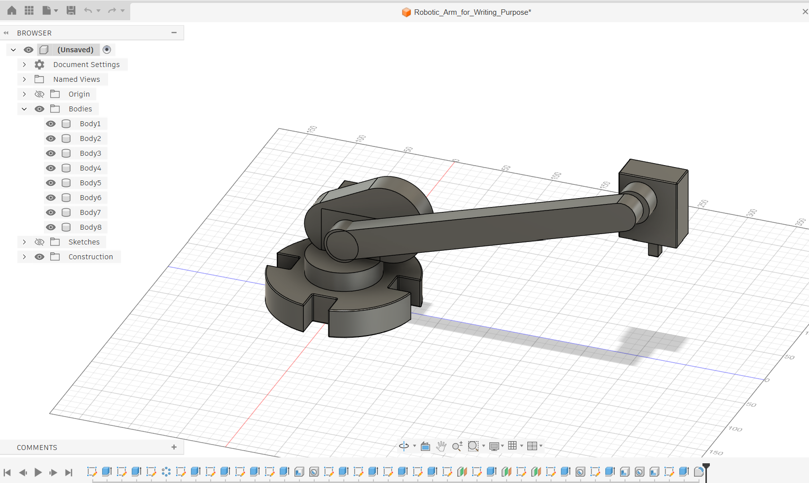
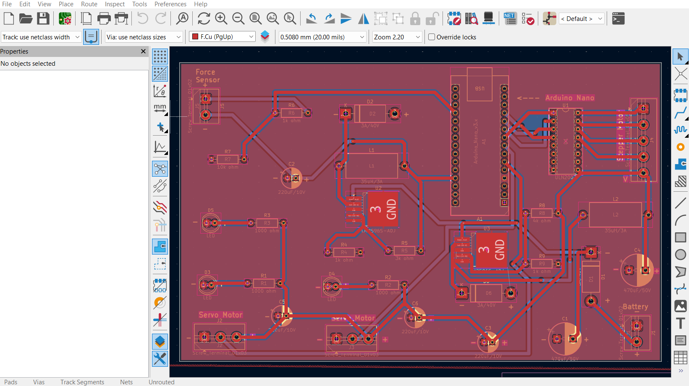
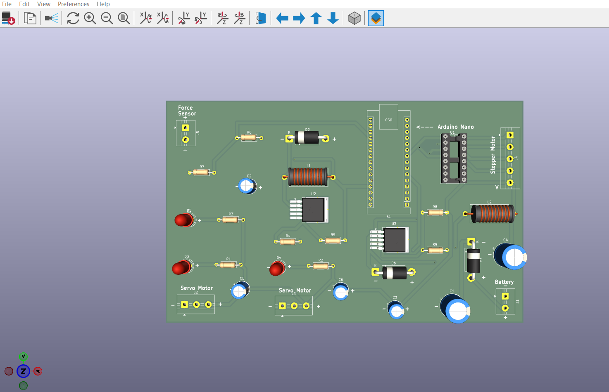
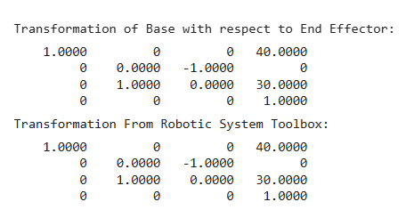
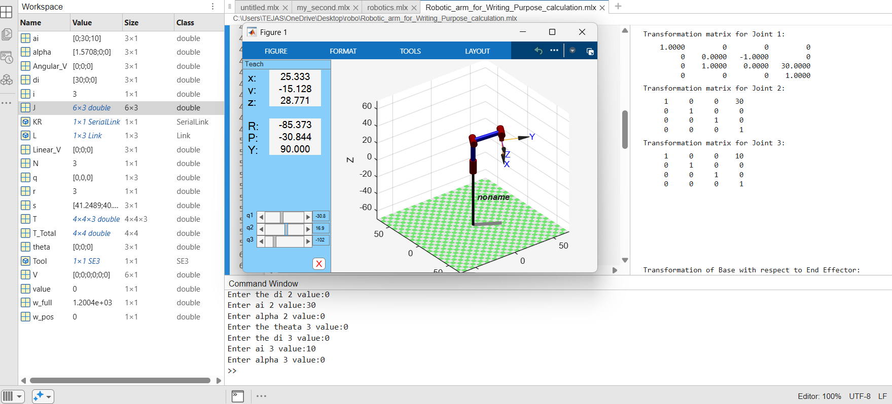

# 5-DOF Robotic Writing Arm

A 5 degree-of-freedom robotic arm that writes any sentence you type. The project covers the full chain: mechanical design in CAD, a custom KiCad PCB, kinematics in MATLAB, a RoboDK simulation, a machine learning model, and Arduino firmware that drives the real arm.

> **Author:** Tejas
> **Tools:** Fusion 360 · KiCad · MATLAB (Robotics Toolbox) · RoboDK · Python · Arduino IDE · Tinkercad

[](robotic-arm-5dof/docs/videos/stimulation_vidio_compressed.mp4)

▶ *Click the image above to watch the simulation video.*

---

## Table of Contents

1. [Overview](#1-overview)
2. [System Architecture](#2-system-architecture)
3. [Repository Structure](#3-repository-structure)
4. [Hardware and Bill of Materials](#4-hardware-and-bill-of-materials)
5. [CAD Design](#5-cad-design)
6. [Electronics and KiCad PCB](#6-electronics-and-kicad-pcb)
7. [Kinematics in MATLAB](#7-kinematics-in-matlab)
8. [Simulation in RoboDK](#8-simulation-in-robodk)
9. [Machine Learning Model](#9-machine-learning-model)
10. [Text to Motion (Python)](#10-text-to-motion-python)
11. [Arduino Firmware](#11-arduino-firmware)
12. [How to Run](#12-how-to-run)

---

## 1. Overview

**Goal:** give the arm a sentence and have it write that sentence on paper.

**What was built:**

- A 5-DOF arm designed in CAD, with a servo-driven joint set and a stepper-driven pen mechanism.
- A custom PCB (KiCad) with power regulation, motor drivers and sensor inputs.
- A kinematic model in MATLAB: DH parameters, forward kinematics, Jacobian, velocity and singularity analysis.
- A simulation in RoboDK to test motions before running the real arm.
- A machine learning model that learns the mapping between end-effector position and joint angles from a dataset generated by the kinematic model.
- Arduino firmware that receives joint angles over serial and drives the servos and stepper, with a force-feedback PID for pen pressure.

---

## 2. System Architecture

```
Sentence ──► Single-stroke font ──► (x, y, pen) points
                                         │
                                         ▼
                            ML model / inverse kinematics
                                         │
                                         ▼
                              Joint angles (q1 ... qn)
                                         │
                                  USB serial (Python)
                                         ▼
                      Arduino Nano ──► Servos + Stepper (pen lift)
                            ▲
                            └── Force sensor (pen pressure PID)
```



---

## 3. Repository Structure

```
robotic-arm-5dof/
├── Arduino_code/         # Arduino firmware (.ino)
├── cad/                  # Fusion 360 files and STL exports
├── docs/
│   ├── images/           # Screenshots used in this README
│   └── videos/           # Simulation video
├── mathlab/              # DH model, kinematics, Jacobian, singularity scripts
├── ml/                   # Dataset generation, training and evaluation
├── pcb/                  # KiCad project (schematic, PCB layout, Gerbers)
├── python/               # Text-to-motion script and serial sender
├── tinkercad/            # Tinkercad Circuits files
└── README.md
```

---

## 4. Hardware and Bill of Materials

| Part | Qty | Notes |
|---|---|---|
| Arduino Nano | 1 | Main controller |
| Servo motors | TBD | Joint actuators (model: TBD) |
| 28BYJ-48 stepper motor | 1 | Pen lift mechanism |
| ULN2003 driver | 1 | Stepper driver |
| LM2596S-ADJ buck converter | 2 | One for Nano logic rail, one for servo/stepper rail |
| Force sensor (FSR) | 1 | Pen pressure feedback on A0 |
| Schottky diode, inductors, capacitors, resistors | TBD | See the KiCad BOM |
| Power supply | 1 | 10 V to 30 V input |
| Screw terminals | TBD | Motor, sensor and supply connections |



---

## 5. CAD Design

The arm was modelled in **Fusion 360**.

**Design steps:**

1. Defined the workspace and the reach needed to cover a sheet of paper.
2. Modelled each link and joint bracket with the servo mounting dimensions.
3. Designed the pen holder with a stepper-driven lift mechanism.
4. Assembled all parts with joints and checked the range of motion.
5. Exported parts as STL for 3D printing, and as a STEP file for RoboDK.



---

## 6. Electronics and KiCad PCB

### 6.1 Circuit description

- **Power input:** 10 V to 30 V supply through a Schottky protection diode and a 470 uF input capacitor.
- **Buck converters:** two LM2596S-ADJ regulators set to about 5 V with a 3k / 1k feedback divider.
  - One feeds the Arduino Nano's 5 V pin.
  - One feeds the servos and the stepper driver.
- **Servo connectors:** 3-pin terminals (power, signal, ground) with a bulk capacitor on the servo rail.
- **Stepper driver:** ULN2003 driving the 28BYJ-48, with the motor common wired to the servo/stepper rail.
- **Force sensor:** FSR from 5 V to A0 with a 10k pull-down resistor to ground.

| Signal | Arduino Nano pin |
|---|---|
| Servo 1 signal | D3 |
| Servo 2 signal | D5 |
| Stepper IN1 to IN4 | D6 to D9 |
| Force sensor | A0 |

### 6.2 PCB layout





**Design notes:**

- Keep the buck converter switching loop (input capacitor, IC, inductor, diode) short and use wide traces.
- Use a common ground for the Nano, the servo rail and the ULN2003.
- Place 100 nF decoupling capacitors close to the Nano.

---

## 7. Kinematics in MATLAB

All calculations are done in MATLAB with the Robotics Toolbox (Peter Corke).

### 7.1 DH parameters

| Joint | theta (deg) | d | a | alpha (deg) |
|---|---|---|---|---|
| 1 | theta1 | 30 | 0  | 90 |
| 2 | theta2 | 0  | 30 | 0  |
| 3 | theta3 | 0  | 10 | 0  |

### 7.2 Transformation matrix

Each joint uses the standard DH transformation:

```
        | cos(t)  -sin(t)*cos(a)   sin(t)*sin(a)   r*cos(t) |
A(i) =  | sin(t)   cos(t)*cos(a)  -cos(t)*sin(a)   r*sin(t) |
        |   0         sin(a)           cos(a)          d     |
        |   0           0                0             1     |
```

where `t` = theta, `a` = alpha, `r` = link length "a", `d` = link offset.



### 7.3 Arm pose plot

```matlab
KR.plot(q);
KR.teach(q);
```



### 7.4 Jacobian and velocity

```matlab
J  = jacob0(KR, q);          % 6 x N
qd = [qd1, qd2, qd3]';       % joint velocities (rad/s)
V  = J * qd;                 % [vx vy vz wx wy wz]'
```

### 7.5 Singularity analysis

For a non-square Jacobian, the determinant is not defined, so these measures are used instead:

```matlab
w_pos = sqrt(det(J(1:3,:) * J(1:3,:)'));   % position manipulability
r     = rank(J);                           % less than N means singular
s     = svd(J);                            % smallest value near 0 means near-singular
```

The singular joint angles are found symbolically: build `J` with symbolic angles, take `det`, then `factor` it. Each `sin(...)` or `cos(...)` factor that can become zero marks a singular configuration.

---

## 8. Simulation in RoboDK

The arm was simulated in **RoboDK** to check reachability, joint limits and collisions before running the real hardware.

**Steps:**

1. Imported the CAD model (STEP/STL) of each link into RoboDK.
2. Created a robot with 5 joints using the same DH parameters as in MATLAB.
3. Set joint limits and the tool frame (pen tip).
4. Created a reference frame for the paper and added a target for each letter stroke.
5. Ran the motion program and checked for singularities and out-of-reach points.


▶ [Watch the simulation video](robotic-arm-5dof/docs/videos/stimulation_vidio_compressed.mp4)

---

## 9. Machine Learning Model

### 9.1 Dataset

The dataset is generated from the MATLAB kinematic model. For each combination of joint angles, the end-effector pose is computed and saved to `dataset.txt`.

### 9.2 SVM model

The dataset contains floating-point (continuous) values, so a **Support Vector Regressor (SVR)** was used. For each input feature, the relationship with the output labels was plotted to understand how the labels are formed.

---

## 10. Text to Motion (Python)

The Python script runs on the laptop (VS Code). It converts a typed sentence into pen strokes and joint angles.

**Steps:**

1. Read the sentence from the terminal and wrap it into lines that fit the paper.
2. Convert each letter into single-stroke line segments using the Hershey font.
3. Scale the strokes to the paper size and cut them into small steps (0.2 cm).
4. Convert each `(x, y)` point to joint angles with the ML model or inverse kinematics.
5. Send `q1,q2,pen` lines to the Arduino over USB serial and wait for `ok`.

**Serial protocol**

```
q1,q2,pen\n        example:  41.3,62.0,1
pen = 0  -> pen up
pen = 1  -> pen down
```

---

## 11. Arduino Firmware

The Arduino Nano receives angles from Python and drives the actuators.

**Features:**

- Smooth servo motion with a limited step per loop.
- Stepper-driven pen lift, with a travel limit as a safety.
- **PID on pen pressure:** the force sensor on A0 is read, and the stepper adjusts the pen height to hold a constant force.
- A calibration command (`F`) that prints the current force reading to the Serial Monitor.

**Tunable settings**

| Setting | Meaning |
|---|---|
| `FORCE_CONTACT` | Reading that means the pen touched the paper |
| `FORCE_TARGET` | Pressure to hold while writing |
| `Kp`, `Ki`, `Kd` | PID gains |
| `MAX_PEN_STEPS` | Safety limit for pen travel |
| `PEN_DIR` | Direction of pen movement (1 or -1) |

---

## 12. How to Run

### 12.1 Requirements

- Arduino IDE (libraries: `Servo`, `Stepper`)
- Python 3.10 or newer
- MATLAB with the Robotics Toolbox (for the kinematics)
- RoboDK (for the simulation)

```bash
pip install Hershey-Fonts pyserial numpy scikit-learn
```

### 12.2 Steps

1. **Build the hardware** and wire the board as in the schematic. Power the servos and stepper from the buck rail, never from the Nano's USB power.
2. **Upload the firmware:** open `Arduino_code/` in Arduino IDE, select the Arduino Nano and the port, then click Upload.
3. **Close the Arduino Serial Monitor**, because only one program can use the COM port.
4. **Find the COM port:**

   ```python
   import serial.tools.list_ports
   for p in serial.tools.list_ports.comports():
       print(p.device, "-", p.description)
   ```

5. **Set the port** in the Python script (for example `COM5`).
6. **Run the script:**

   ```bash
   python python/write.py
   ```

7. Type a sentence at the prompt. The arm starts writing.